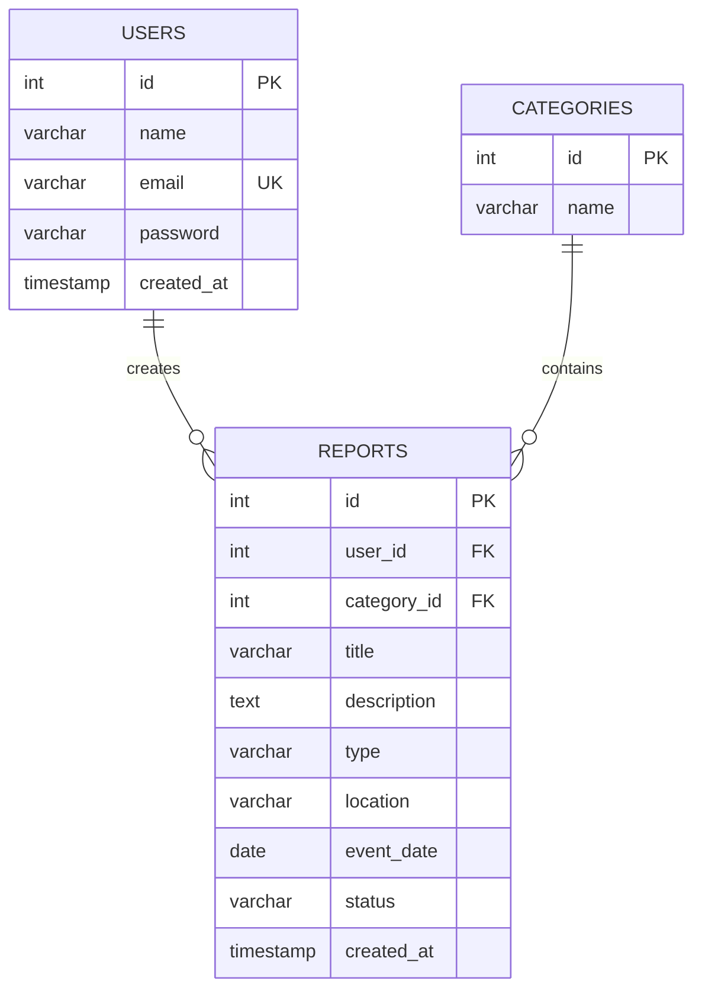

# QaytaTap — ER-диаграмма

Бұл диаграмма жобаның дерекқорындағы негізгі кестелер мен олардың байланысын көрсетеді.

## Кестелердің байланысы

- **USERS → REPORTS:** бір пайдаланушы бірнеше хабарландыру жариялай алады.
- **CATEGORIES → REPORTS:** бір санатта бірнеше хабарландыру болуы мүмкін.
- `user_id` — USERS кестесіне сілтеме жасайтын сыртқы кілт.
- `category_id` — CATEGORIES кестесіне сілтеме жасайтын сыртқы кілт.

PK — негізгі кілт, FK — сыртқы кілт, UK — қайталанбайтын мән.
